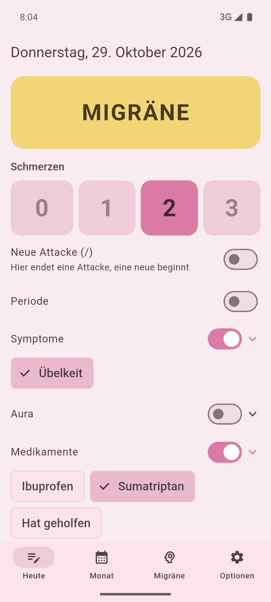
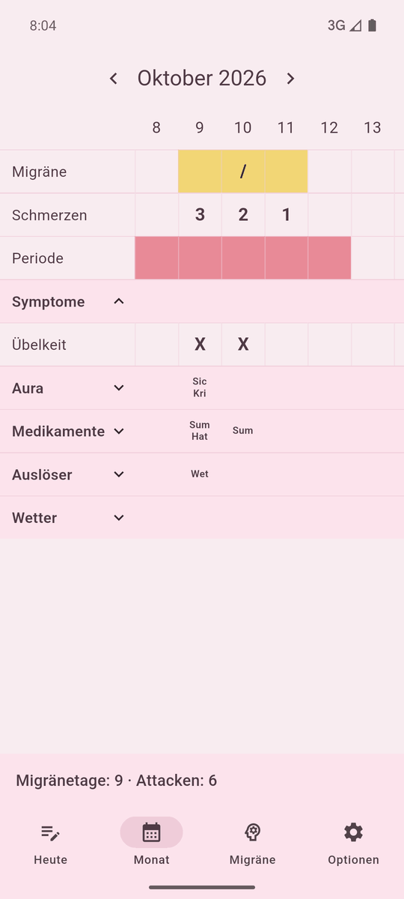
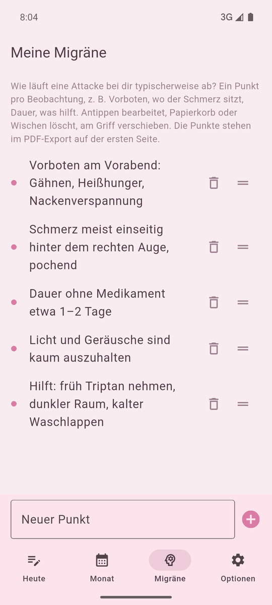
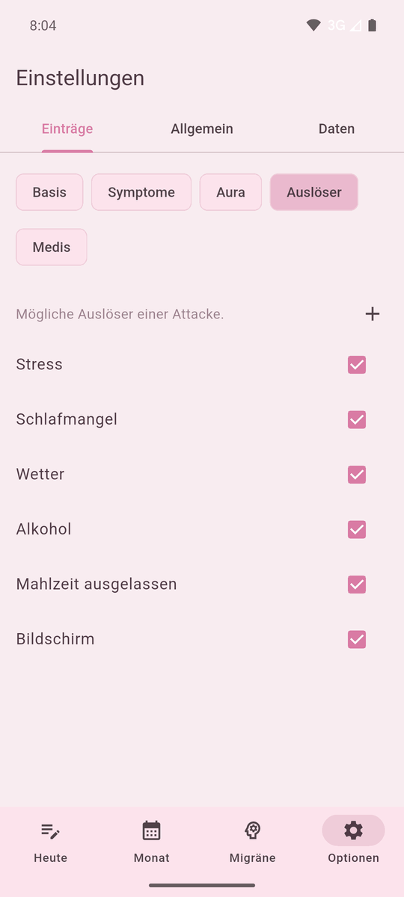

# SimpleMigr

Einfaches Migräne-Tagebuch für Android, nachgebaut nach der Papiertabelle:
Zeilen = Symptome, Spalten = Tage eines Monats.

<p>
  
  
  
  
</p>

<sub>Screenshots mit erfundenen Beispieldaten.</sub>

## Download

Die fertige APK gibt es unter [Releases](https://github.com/dacown87/SimpleMigr/releases/latest).

1. `app-release.apk` auf das Android-Gerät laden.
2. Öffnen und die Installation aus unbekannten Quellen erlauben, falls Android danach fragt.

Die APK ist mit einem eigenen Release-Schlüssel signiert und nicht im Play Store. Updates lassen sich nur über eine APK mit demselben Schlüssel einspielen.

Beim Start prüft die App auf GitHub, ob es eine neuere Version gibt, und zeigt dann einen Hinweis. „Installieren“ lädt die APK und öffnet den Android-Installer; beim ersten Mal muss Android die Installation aus dieser App erlauben. Ohne Internet passiert nichts.

## Funktionen

- Monatsraster wie auf Papier: Hauptzeilen immer sichtbar, Symptome, Aura, Medikamente, Auslöser und Wetter aufklappbar; zugeklappt zeigen Kürzel, was an dem Tag gewählt ist
- Schnelleintrag für heute, auch während einer Attacke in wenigen Taps
- Schmerzen (0–3), Migräne, Periode, Übelkeit, Aura mit eigenen Aura-Symptomen
- Medikamente genommen, mit eigenen Substanzen (z. B. Sumatriptan, Ibuprofen), danach „Hat geholfen“
- „Neue Attacke“ (`/`) markiert, dass an dem Tag eine Attacke endet und eine neue beginnt
- Auslöser aus einer erweiterbaren Liste plus freie Notiz
- Wetter wird mitgespeichert; der Ort lässt sich per Name oder Postleitzahl suchen (Standard Deutschland)
- Tägliche Erinnerung
- „Meine Migräne“: die eigene Migräne in einzelnen Punkten beschreiben (hinzufügen, bearbeiten, verschieben, wischen zum Löschen); steht im PDF auf der ersten Seite
- PDF-Export im Look der Papiertabelle
- Zusammenfassung für den Arzt (eine Seite A4): Verlauf je Monat, Attacken, Aura- und Begleitsymptome nach Gruppen, Zyklusbezug, Medikamente, datenbasierte Fragen. Rechnet lokal, ohne KI
- Sicherung (JSON, alles inklusive Wetter) und Tabelle (CSV) speichern; beides lässt sich wieder importieren, auch eigene Tabellen aus Excel/LibreOffice. Für importierte Migränetage wird das Wetter nachgeladen
- Einstellungen in Tabs: Einträge, Allgemein, Daten. Alle Symptome, Auslöser und Medikamente sind dort anpassbar

Alle Daten bleiben lokal auf dem Gerät, es gibt kein Konto. Das Internet wird nur für den Wetterabruf genutzt.

## Entwicklung

Flutter und Drift (SQLite), nur Android.

```
flutter pub get
flutter test
flutter run
flutter build apk --release
```

Den Entwurf und die fachlichen Regeln beschreibt [PLAN.md](PLAN.md), Aufbau und Release-Ablauf stehen in [docs/ENTWICKLUNG.md](docs/ENTWICKLUNG.md).
