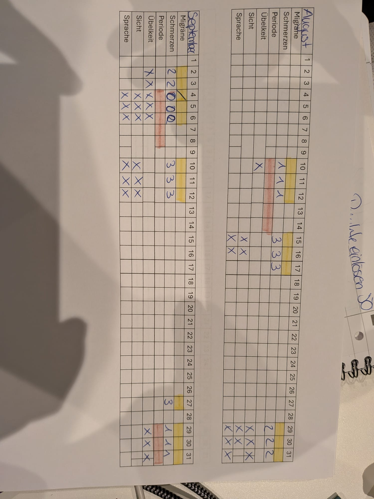

# SimpleMigr

Einfaches Migräne-Tagebuch für Android, nachgebaut nach der Papiertabelle:
Zeilen = Symptome, Spalten = Tage eines Monats.



## Download

Die fertige APK gibt es unter [Releases](https://github.com/dacown87/SimpleMigr/releases/latest).

1. `app-release.apk` auf das Android-Gerät laden.
2. Öffnen und die Installation aus unbekannten Quellen erlauben, falls Android danach fragt.

Die APK ist mit einem Debug-Schlüssel signiert und nicht im Play Store. Updates lassen sich nur über eine APK mit demselben Schlüssel einspielen.

## Funktionen

- Monatsraster wie auf Papier
- Schnelleintrag für heute, auch während einer Attacke in wenigen Taps
- Schmerzen (0–3), Migräne, Periode, Übelkeit, Aura mit eigenen Aura-Symptomen
- „Neue Attacke“ (`/`) markiert, dass an dem Tag eine Attacke endet und eine neue beginnt
- Auslöser aus einer erweiterbaren Liste plus freie Notiz
- Wetter wird mitgespeichert
- Tägliche Erinnerung
- PDF-Export im Look der Papiertabelle
- Alle Symptome und Auslöser sind in den Einstellungen anpassbar

Alle Daten bleiben lokal auf dem Gerät, es gibt kein Konto. Das Internet wird nur für den Wetterabruf genutzt.

## Entwicklung

Flutter und Drift (SQLite), nur Android.

```
flutter pub get
flutter test
flutter run
flutter build apk --release
```

Den Entwurf und die fachlichen Regeln beschreibt [PLAN.md](PLAN.md).
